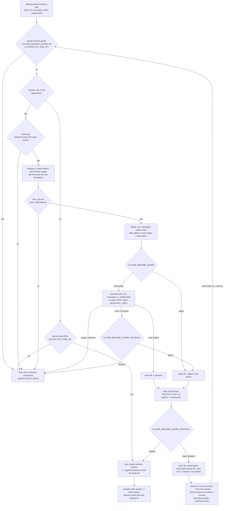

# multica-agent-runtime

Container images that run the [Multica](https://github.com/multica-ai/multica) agent daemon with
**Claude Code**, **Codex**, **OpenCode 2**, **Pi** and **Oh My Pi**, made for Kubernetes: Docker-in-Docker (rootless or
rootful), a CUDA variant with GPU access for nested containers, Chrome for Testing + Playwright for
browser tests, Nix with configurable caches, `gh` and `tea`, a web terminal for the CLI logins, and a
management web UI that deletes the workspace data of finished tasks.

```
ghcr.io/niki-on-github/multica-agent-runtime:<multica-version>-<variant>[-<sha7>]
                                             │                 │          └ commit of this repo (immutable)
                                             │                 └ cpu | cuda
                                             └ Multica version of the bundled `multica` CLI/daemon, e.g. v0.8.0
```

**The version in the tag is the Multica agent (daemon) version**, not a version of this repo: the
`multica` binary is copied from `ghcr.io/multica-ai/multica-backend:<multica-version>`. Pick the tag
that matches your Multica server. Everything else in the image (Claude Code, Codex, Chrome,
Docker, ...) is updated by Renovate independently and does not change the version part; the exact
versions of an image are in `/etc/multica-agent-runtime/versions.json` (`doctor` prints them).

| Tag | Example | Moves? |
|---|---|---|
| `<multica-version>-<variant>-<sha7>` | `v0.8.0-cuda-9b973bc` | no: one build. Pin this (plus `@sha256:` digest) in deployments |
| `<multica-version>-<variant>` | `v0.8.0-cuda` | yes: newest build for this Multica version |
| `<variant>` | `cuda` | yes: newest build for the newest Multica version |

| Variant | Base | Use |
|---|---|---|
| `cpu` | `ubuntu:26.04` | default |
| `cuda` | `nvidia/cuda:<cuda-version>-runtime-ubuntu26.04` + nvidia-container-toolkit | GPU runner: CUDA in the agent container and in nested containers |

Both variants run **Ubuntu 26.04 LTS** (switched from 24.04). Keep the two bases on the same release:
the Docker CE apt repository and package version are derived from the base's `/etc/os-release`
(`VERSION_CODENAME`/`VERSION_ID`), and Chrome's `deb.deps` names are mapped to the release's packages
at build time (e.g. `libasound2` → `libasound2t64`). Images are rebuilt on every dependency update
(Renovate) and weekly (Ubuntu security updates).

## What is inside

| | |
|---|---|
| Multica | `multica` CLI/daemon (copied from the official backend image) |
| Agents | Claude Code, Codex, OpenCode 2, Pi (all npm), Oh My Pi (release binary); pinned, auto-update off |
| Browser | Chrome for Testing at `/opt/google/chrome/chrome`, `@playwright/test`, Playwright MCP, chrome-devtools-mcp, xvfb |
| Containers | Docker engine (rootless extras, buildx, compose), slirp4netns, fuse-overlayfs; cuda: nvidia-container-toolkit, nvtop |
| Git | git, git-lfs, gh, tea, openssh-client |
| Dev | Node 26, npm, pnpm, Python 3.14 + venv + pip, uv/uvx, build-essential, Nix (single-user, flakes) |
| Shell | bash, vim, tmux, ttyd, jq, yq, ripgrep, fd, rsync, sqlite3, curl, wget, bubblewrap, socat, network/debug tools |

Everything else comes through Nix: `nix shell nixpkgs#go -c go version`.
`doctor` (or `doctor --json`) shows versions, logins, Docker mode, GPU and cache reachability.

## How Multica uses the agents

The daemon finds every supported CLI on `PATH` and registers **one runtime per CLI and workspace**
named `$MULTICA_AGENT_RUNTIME_NAME · <CLI>` (e.g. "multica-agent-gpu-01 · Claude Code"). In the Multica UI
an agent is bound to one runtime and model; issues assigned to it run with that CLI. Several runners
(e.g. a cpu and a cuda one) can serve the same workspace: give each its own `MULTICA_DAEMON_ID`,
runtime name and `/home/agent` volume (logins are per runner). Build with
`--build-arg AGENTS="claude codex"` to leave one out (choices: `claude`, `codex`, `opencode`, `pi`,
`omp`). The daemon detects CLIs and their models at start: restart it after logging in to a CLI.

OpenCode 2 is installed from `@opencode/cli`, which provides both `opencode` and `opencode2`. Multica
detects `opencode` and registers it as the **OpenCode** runtime (the CLI's major version selects
Multica's OpenCode 2 backend); `opencode2` is the v2 command for use in the web shell. Multica does not
detect a separate `opencode2` runtime.

## Commands

`tini` runs `entrypoint.sh <command>`:

| Command | |
|---|---|
| `daemon` (default) | `multica login --token $MULTICA_TOKEN`, then `multica daemon start --foreground`; starts Docker per `DIND_MODE` (default `auto`). Without a token it logs a hint and waits. |
| `shell` | web terminal (`ttyd`) on `$TTYD_PORT` (7681): a login shell per browser tab; `https://<host>/?arg=tmux` attaches the persistent tmux session `main` instead. Uses an existing Docker daemon, never starts one. **No authentication of its own**, see [Web shell](#web-shell). |
| `webui` | management web UI on `$WEBUI_PORT` (8090): agent tasks, resource usage, workspace cleanup and browser terminals, see [Management web UI](#management-web-ui). Uses an existing Docker daemon, never starts one. |
| `doctor [--gpu] [--json] [--strict]` | runtime check |
| anything else | runs it after the same setup (`DIND_MODE` default `off`) |

Startup (both `daemon` and `shell`): `$HOME` is seeded from `/etc/agent-skel` (missing files only),
the CA bundle is spread to all tools, git/gh/tea are configured from env, a CDI spec is generated
for visible GPUs, Docker is started.

## Web shell

`shell` runs [ttyd](https://github.com/tsl0922/ttyd): a full terminal as the agent user, with every token
of the container (Multica, GitHub, LLM keys, CLI logins) and the Docker daemon. ttyd itself has **no
login** (it only checks the WebSocket origin), so never expose port 7681 directly. Put it behind an
**authenticating reverse proxy** (also called an auth proxy or SSO/OIDC gateway) that lets only you
through, for example:

- OIDC at the ingress/gateway: Envoy Gateway `SecurityPolicy` (`oidc`), Traefik/NGINX forward auth
- a dedicated proxy in front: [oauth2-proxy](https://github.com/oauth2-proxy/oauth2-proxy),
  [Pomerium](https://www.pomerium.com/), Authelia, Authentik
- a tunnel with access control: Tailscale, Cloudflare Access

Use TLS (the terminal and OAuth codes go over the WebSocket), allow only the proxy to reach the port
(NetworkPolicy), and do not add exceptions for "internal" IPs. Without such a proxy use
`kubectl port-forward` / `docker run -p 127.0.0.1:7681:7681`, or as a minimal fallback ttyd's basic
auth: `TTYD_ARGS="--credential user:password"` (over TLS only).

## Management web UI

`webui` serves a management page for the runtime: one page, Python standard library plus xterm.js
from the image, no build step, no Multica server access (it is deliberately not part of the Multica
UI). Five views:

- **Overview**: the **agents** (Claude Code, Codex, OpenCode, Pi, Oh My Pi: version, login, registered
  with the daemon, running tasks), **Claude Code usage** (below), the daemon's status (`/health`: id,
  version, uptime, running/active tasks), the **running agent tasks** (each agent CLI with its task directory, issue, model, and the CPU and
  memory of its whole process tree), resource usage with 6-minute history (node CPU and memory, CPU
  of the runtime's processes, network), filesystems, this container's cgroup limits, GPUs
  (`nvidia-smi`), the nested Docker containers and the top processes.
- **Workspaces**: the data below `/data/workspaces` per workspace and per **task directory** (size,
  last activity, issue/agent, status **Deletable** / **In use** / **Protected**). Delete single task
  directories, all idle tasks of a workspace, or whole workspaces that are not in use.
- **Maintenance**: free space — delete task data unused for N days, `docker … prune` (stopped
  containers, dangling or all unused images, networks, build cache, optionally anonymous volumes,
  everything with an age filter), Nix garbage collection (`nix-collect-garbage --delete-older-than`),
  empty `.webui-trash`. Each step can be previewed or run now, and all of them run **automatically**
  on a schedule (daily at a time, or every N hours) with the options set in the page. Settings and the
  run history live in `~/.local/state/multica-webui/maintenance.json` (`WEBUI_STATE_DIR`); the
  `WEBUI_AUTO_CLEANUP*` / `WEBUI_CLEANUP_*` variables only give the defaults of a fresh file.
- **Environment**: the environment variables of this container, the Multica daemon and each running
  agent task (from `/proc/<pid>/environ`: what the agent CLI really got, after the sandbox's env
  filter; "differs" marks values that are not the same as in the webui container). Secrets — names
  like `*TOKEN*`, `*KEY*`, `*SECRET*`, `*PASSWORD*`, token-looking values, passwords in URLs — are
  masked; **Reveal** / **Copy** fetch one value with a separate, CSRF-guarded and logged request.
  `WEBUI_AUTH*` is never shown. `WEBUI_ENV=masked` (or read-only mode) disables revealing,
  `WEBUI_ENV=0` the whole view.
- **Terminal**: browser terminals (xterm.js over a WebSocket to a PTY), several at once as tabs: a
  login shell, the shared tmux session `main` (the same one as `shell`'s `?arg=tmux`), or a shell
  opened directly in a task's directory ("Shell" in the agent and workspace lists).

**Claude Code usage** is computed from Claude Code's own session transcripts
(`~/.claude/projects/**/*.jsonl` and the sandbox's `/data/agent-homes/*/.claude`, one usage record per
API response): tokens of the current 5-hour block (with its reset time), today, 7 and 30 days, per
day and per model, plus the login (subscription type). Nothing is sent anywhere. The plan's
percentage limits (`/usage` in Claude Code) are not in those files, so they are not shown.

The simplest setup runs the UI **inside the daemon container**: `WEBUI_EMBEDDED=1` on the `daemon`
command starts it next to the daemon (restarted if it crashes). It then sees the daemon's processes
and task locks, the Nix store the agents use, and that container's cgroup — no shared PID namespace
needed. As its own container in the pod instead, share `/data`, `/home/agent` and `/run/agent`, and
set `shareProcessNamespace: true` on the pod so that it sees the daemon's processes (see
[What "in use" means](#what-in-use-means)); its Nix GC then only cleans its own `/nix` (each container
has its own, the page says so):

```sh
docker build --build-arg VARIANT=cpu -t agent-runtime:webui .   # or your own pushed image
docker run -d --name multica-webui -p 127.0.0.1:8090:8090 \
  --pid container:<daemon container> \
  -v agent-data:/data -v agent-home:/home/agent -v agent-run:/run/agent \
  -e WEBUI_AUTH=admin:change-me \
  agent-runtime:webui webui
```

```yaml
spec:
  shareProcessNamespace: true      # the webui sees the daemon's tasks (processes and task locks)
  containers:
    - name: webui
      image: <your registry>/multica-agent-runtime:webui   # built from this fork (see above)
      args: ["webui"]
      ports: [{name: webui, containerPort: 8090}]
      env:
        - {name: WEBUI_AUTH, valueFrom: {secretKeyRef: {name: multica-webui, key: auth}}}
        - {name: MULTICA_DAEMON_PORT, value: "19514"}   # daemon status, same pod
      envFrom:
        - secretRef: {name: multica-runner}             # the terminal's shells get the same tokens
      securityContext: {runAsUser: 1000, runAsGroup: 1000, allowPrivilegeEscalation: false}
      volumeMounts:
        - {name: data, mountPath: /data}
        - {name: home, mountPath: /home/agent}
        - {name: run, mountPath: /run/agent}            # Docker socket of the app container
```

The resource numbers come from `/proc` and `/sys/fs/cgroup` as this container sees them: node CPU and
memory (unless lxcfs virtualises them), the processes of its PID namespace (with a shared one: the
whole pod - daemon, agents, browsers, tools), and the cgroup limits of the webui container itself.

### What "in use" means

The state is computed per task directory, and checked again immediately before deleting:

| Signal | |
|---|---|
| a live process has its working directory or an open file inside the task directory | a running agent task (a webui terminal shows as "web terminal") |
| the task's `.task_lock` is locked (`/proc/locks`, any lock type) | the daemon is working on that task |
| the newest file is younger than `WEBUI_ACTIVITY_GRACE` (default 300 s) | just finished, or an idle moment of a running task |
| **blind mode**: the daemon's process is not visible from here and the daemon does not report 0 running tasks — then anything changed within `WEBUI_BLIND_GRACE` (default 6 h) | the UI runs without a shared PID namespace: processes and locks of other containers are invisible |

A workspace is in use when one of its tasks is (or something else in it is). The page shows a banner
in blind mode; fix it with `shareProcessNamespace: true` (or `--pid container:<daemon>` with Docker).
`WEBUI_ASSUME_SHARED_PID=1` turns blind mode off when you know better, `WEBUI_BLIND_GRACE=0` too.

Anything that cannot be deleted on purpose goes into `WEBUI_PROTECT_WORKSPACES` (comma separated ids,
slugs or directory names). `WEBUI_READ_ONLY=1` disables deletion and the terminal (a pure overview).

Deletion renames the directory into `<root>/.webui-trash` first: atomic, so the daemon never sees a
half-deleted task (use `WEBUI_KEEP_TRASH_HOURS` to undo a mistake, and see the leftovers there for
files a nested rootful container created as root — the agent user cannot remove those). Symlinks inside
are removed, never followed. Only the local data is deleted; the workspace, issues and agents stay in
Multica, and the daemon creates new directories for the next task (a deleted task directory cannot be
resumed by a later run of the same issue).

### Security

The page deletes data and opens shells as the agent user (with every token in its environment and
Docker access), so it needs a login: without `WEBUI_AUTH` (or `WEBUI_AUTH_FILE`) the server binds to
`127.0.0.1` or refuses to start. With an **authenticating reverse proxy** in front — as for the
[web shell](#web-shell) — set `WEBUI_INSECURE=1` and keep the port off the network with a
NetworkPolicy. `WEBUI_AUTH` is HTTP Basic auth, so put TLS in front of it, never plain HTTP over a
network. `WEBUI_SHELL=0` removes the terminal.

The page loads nothing from the internet and runs under a CSP without inline scripts. Deletions need a
same-origin request with the page's `X-WebUI` header, and the terminal WebSocket is only accepted with
an `Origin` header of the page itself (a WebSocket is not covered by CORS: without that check any site
could open a shell with the browser's cached credentials). Behind a proxy that rewrites `Host`, list
the public origin in `WEBUI_ALLOWED_ORIGINS` (e.g. `https://runner.example.com`).

A task that starts in the milliseconds between the check and the rename cannot be prevented, but it
would just recreate the directory.

## Logins and persistence

Mount a volume at `/home/agent`: logins and CLI state live there and survive restarts.

| Tool | Login | Alternative |
|---|---|---|
| Claude Code (subscription) | `claude` → `/login` in the web shell (shows a URL, paste the code back) | `CLAUDE_CODE_OAUTH_TOKEN` from `claude setup-token` (1 year), `ANTHROPIC_API_KEY`, `ANTHROPIC_BASE_URL` |
| Codex | `codex login --device-auth` | `OPENAI_API_KEY` |
| OpenCode 2 | `opencode2` → `/connect` in the web shell (provider + credentials) | provider API keys (e.g. `ANTHROPIC_API_KEY`, `OPENAI_API_KEY`) |
| Pi | `pi` → `/login` in the web shell | provider API keys (e.g. `ANTHROPIC_API_KEY`, `OPENAI_API_KEY`) |
| Oh My Pi | `omp` → `/login` in the web shell | provider API keys (e.g. `ANTHROPIC_API_KEY`, `OPENAI_API_KEY`) |
| Multica | – | `MULTICA_TOKEN` (personal access token), re-applied on every start |
| GitHub | – | `GH_TOKEN` (gh as git credential helper) |
| Gitea | – | `GITEA_URL` + `GITEA_TOKEN` (`tea` login + git credential helper; `GITEA_USER` optional) |

Do the logins in the default web shell, not in `?arg=tmux`: the browser terminal wraps a long OAuth
URL itself, so clicking or copying it gets the whole URL. tmux redraws wrapped lines row by row,
which cuts the URL at the row end (e.g. `Invalid OAuth request: Missing state parameter`).

MCP servers with an OAuth `localhost` callback: open the URL, let the browser fail on the
redirect, copy that URL and run `curl '<url>'` in the web shell.

`CLAUDE_CONFIG_DIR=$HOME/.claude` keeps all Claude Code state in one directory. Optional SSH keys:
mount them at `/etc/agent-ssh` (copied to `~/.ssh` with mode 600).

## Task sandbox

Without it, every task is a child of the daemon: same uid, same `HOME`, the daemon's whole
environment (`GH_TOKEN`, API keys, …), the other tasks' directories and processes. With
`AGENT_SANDBOX=on` the entrypoint points `MULTICA_{CLAUDE,CODEX,OPENCODE,PI,OMP}_PATH` at shims that run each
task's CLI through [`agent-sandbox`](rootfs/usr/local/bin/agent-sandbox) in bubblewrap. No Multica
changes are needed.

| Inside the sandbox | |
|---|---|
| the task's own directory, `$TMPDIR`, the repo cache of its Multica workspace | rw, same paths |
| `HOME=/data/agent-homes/<agent id>` | per agent, persistent (session resume, caches), seeded like the runner home |
| `/home/agent/.claude` | the per-agent `.claude`; this task's `projects/<cwd>` transcripts are the runner's (the daemon checks them for resume) |
| logins of this CLI: Claude `.credentials.json`, Codex `auth.json`, Pi/omp `auth.json` | rw (token refresh), `models.*` and `extensions/` ro |
| OpenCode `opencode.db` | copied from the runner on first use into the per-agent home (credentials + sessions stay per agent) |
| `/usr`, `/etc`, `/opt`, `/var` ro, `/nix` rw, Docker socket, GPU device nodes | shared |
| own `/tmp`, `/dev/shm`, `/run`, PID/IPC/UTS namespaces | private |

Not inside: the daemon and other processes, the runner home, other tasks' directories, and
**variables whose name looks secret** (`*TOKEN*`, `*SECRET*`, `*API_KEY*`, `*PASSW*`, `*_KEY`, …).
Pass the ones a task needs with `AGENT_SANDBOX_PASS_ENV`: runner-wide in the pod env, per agent in the
agent's custom env (they add up). Typical: `CLAUDE_CODE_OAUTH_TOKEN` (Claude needs no file and no
refresh then), the provider key Pi's `models.json` names (e.g. `LLM_API_KEY`), `GH_TOKEN` for
agents that push. `MULTICA_*` cannot be passed; the task-scoped `MULTICA_TOKEN` is always there, the
daemon's own never.

Docker works as before, but it is **not** an isolation boundary: a container can mount any path of
the pod. Bind mounts of the work dir, `$HOME` and `$TMPDIR` work, `/tmp` inside the sandbox is
private (`docker run -v /tmp/x` mounts the pod's `/tmp`). `AGENT_SANDBOX_DOCKER=0` (agent custom env)
takes the socket away from that agent.

With the sandbox on, the entrypoint sets `MULTICA_WARM_POOL=off` (unless set): the daemon's warm
session pool (Multica v0.12+) hands warm Claude/Codex processes their task token through a file in
the daemon's `/tmp`, which the sandbox cannot see.

`AGENT_SANDBOX=required` refuses to start the daemon when bwrap cannot create namespaces (the pod
needs the same settings as rootless Docker); `on` then runs unsandboxed with a warning. `doctor`
shows the state.

## Claude Code: cold resumes

Multica continues an issue by resuming the agent's Claude session (`claude --resume <id>`). The prompt cache
of a session lasts minutes to an hour, so a resume after a usage-limit pause, a night or a quiet issue has to
read the **whole conversation uncached** first. For a session near 1M context, that one request can use a large
part of a plan's 5-hour window. Two defaults keep it affordable:

**Earlier auto-compact.** `CLAUDE_CODE_AUTO_COMPACT_WINDOW=400000` is set unless you set the variable yourself
(pod env, or an agent's custom env in Multica) or a Claude settings file (`$CLAUDE_CONFIG_DIR/settings.json`,
`managed-settings.json`) sets `autoCompactWindow` or that variable. Sessions then compact at about 400k
instead of near 1M. `CLAUDE_CODE_AUTO_COMPACT_WINDOW=off` keeps Claude's own default.

**Cold-resume guard** ([`claude-resume-guard`](rootfs/usr/local/bin/claude-resume-guard), on by default). The
entrypoint points `MULTICA_CLAUDE_PATH` at a shim that checks every task's `--resume` before Claude starts. It
works with and without the task sandbox, and wraps a `MULTICA_CLAUDE_PATH` you set yourself.

| Situation | What happens |
|---|---|
| new session, no transcript, probe, warm (idle < 30 min) or small (< 150k tokens) | nothing: Claude starts unchanged |
| cold and big | the transcript is cut down to a digest (user messages, replies, tools, files touched; no tool output, usually a few % of the context), and a small model (`haiku`) turns it into a hand-off note. The guard then **declines the resume** the way Claude does for a missing session (`No conversation found with session ID: <id>`) without starting Claude. Multica (v0.13) treats that as a refused resume: it retires the session and retries the task once **without** it, with its own cold-start prompt and continuity notice. The guard gives that retry the hand-off note (`--append-system-prompt-file`) |
| the summary call hits a usage/rate limit | resumes unchanged (a resume fails the same way, and the daemon keeps its session) |
| the summary call fails or takes longer than 180 s | the digest itself is the hand-off (`CLAUDE_RESUME_GUARD_FALLBACK=resume`: resumes unchanged) |



The summary call asks for `haiku` (`CLAUDE_RESUME_GUARD_MODEL`). That is Claude Code's alias for the current Haiku
model; the guard does not check which model answered.

The daemon then stores the new session for the issue. The old transcript stays on disk (`claude --resume <id>`
in the web shell still opens it). The agent gets Multica's cold-start prompt (full comment reading) plus the
note, which tells it to re-read the issue comments and the work tree. The task log shows the declined resume
and Multica's "retrying with fresh session" next to the guard's line. Detail of the old conversation that is not in the note is lost: that is the trade-off for a cold
start of a few thousand tokens instead of hundreds of thousands. Each decision is logged as one
`claude-resume-guard:` line in the task log and in `~/.local/state/claude-resume-guard/events.jsonl` (`doctor`
counts them). The declined first run never starts Claude, so the summary is not bound by the 60 s the daemon
gives Claude's startup handshake.

`CLAUDE_RESUME_GUARD_STRATEGY=replace` skips the round trip: Claude starts at once without `--resume` and with
the note. Multica's prompt then still assumes a resumed session, and the summary has to fit that handshake
(default timeout 50 s). Use it with a Multica version that does not retry a refused resume.

## Docker-in-Docker

Real `dockerd`, listening on `DOCKER_HOST=unix:///run/agent/docker.sock`, data in
`$DIND_DATA_ROOT` (`/data/docker`, must be a volume). Mode by `DIND_MODE`:

| Mode | Container needs |
|---|---|
| `auto` | picks the first that works: existing daemon → `external`, root + privileged → `rootful`, else `rootless` if its prerequisites are met (missing ones are logged), else `off` |
| `rootless` | seccomp + AppArmor unconfined, unmasked `/proc`, `/dev/net/tun`, `CAP_SYS_ADMIN` in the bounding set and no `no_new_privs` (both for the setuid `newuidmap`; the agent has no effective capabilities). In a user-namespaced pod start as root (uid 0 of the namespace) so the entrypoint can fit the subordinate ids |
| `rootful` | `--privileged`, started as root (`--user 0`); the agent uses the daemon through the `docker` group |
| `external` | only the CLI, against `DOCKER_HOST` |
| `off` | no Docker |

`/run/agent` is usually an `emptyDir`, which survives container restarts together with the files of
the previous daemon. Files a rootless daemon created belong to its subordinate ids, so only root can
remove them: start the container as root (as for rootless on Kubernetes), the entrypoint cleans up
before it drops to the agent user.

Publish container ports on loopback (`-p 127.0.0.1:8080:8080`) and test against `127.0.0.1`; in
rootless mode container IPs are not reachable from the agent.

```sh
# rootless, as on Kubernetes (docs/kubernetes.md)
docker run --rm -it \
  --security-opt seccomp=unconfined --security-opt apparmor=unconfined --security-opt systempaths=unconfined \
  --cap-add SYS_ADMIN --device /dev/net/tun -v agent-home:/home/agent -v agent-data:/data \
  -e DIND_MODE=rootless ghcr.io/niki-on-github/multica-agent-runtime:cpu bash -l

# rootful
docker run --rm -it --privileged --user 0 -v agent-home:/home/agent -v agent-data:/data \
  -e DIND_MODE=rootful ghcr.io/niki-on-github/multica-agent-runtime:cpu bash -l
```

## GPU (cuda image)

Give the container the GPU (`runtimeClassName: nvidia` on Kubernetes, `--gpus all` with Docker).
At start `nvidia-ctk cdi generate` writes a CDI spec of exactly what the container sees, so nested
containers get the GPU with `docker run --device nvidia.com/gpu=all ...` (`--gpus all` works too).
Rootless mode runs the NVIDIA hook with `no-cgroups`.
The NVIDIA hook of the outer runtime mounts a file over `/proc/driver/nvidia/params`; any mount on top of
`/proc` makes the kernel refuse new proc mounts, so every nested container would fail (`runc ... error
mounting "proc" ... operation not permitted`, also with `--privileged`). The entrypoint removes that
mount when the container starts as root (also uid 0 of a user-namespaced pod).
In a user-namespaced pod the GPU device nodes belong to the overflow id 65534, which `nvidia-ctk`
copies into the spec (`gid`, `additionalGids`); rootless Docker cannot map it (`setgroups: invalid
argument`), so the entrypoint drops those ids from the spec. The NVIDIA runtime is set to `mode = "cdi"`:
`--runtime=nvidia -e NVIDIA_VISIBLE_DEVICES=all` and `--device nvidia.com/gpu=all` use the same spec.
On NixOS nodes `nvidia-smi` and the other driver tools are Nix binaries whose ELF interpreter (glibc)
lives elsewhere in `/nix/store`; the entrypoint adds those store paths to the spec, otherwise nested
containers fail with `exec /usr/local/bin/nvidia-smi: no such file or directory`. `NVIDIA_CDI_ARGS` passes extra flags (e.g.
`--library-search-path` for unusual driver locations). `doctor --gpu` runs `nvidia-smi` in a nested
CUDA container.

All fixes above only act when their problem is present, so the same image works on Kubernetes and
plain Docker, on NixOS and on common distributions (driver in `/usr/lib`, nothing to add). The host
needs the NVIDIA driver and the NVIDIA Container Toolkit (`--gpus all` must work there). With plain
Docker start as root, since the image's default user is 1000:

```sh
docker run --rm -it --gpus all --user 0 \
  --security-opt seccomp=unconfined --security-opt apparmor=unconfined --security-opt systempaths=unconfined \
  --cap-add SYS_ADMIN --device /dev/net/tun -v agent-home:/home/agent -v agent-data:/data \
  -e DIND_MODE=rootless ghcr.io/niki-on-github/multica-agent-runtime:cuda doctor --gpu
```

Test images for nested containers: `nvidia/cuda:<version>-base-ubuntu26.04` (`nvidia-smi`), the CUDA
samples (`nvcr.io/nvidia/k8s/cuda-sample:vectoradd-*`, prints `Test PASSED`) or PyTorch
(`torch.cuda.get_device_name(0)`).

## Browser testing

Chrome for Testing sits at the default Chrome path, so Playwright (`channel: 'chrome'`),
Playwright MCP and chrome-devtools-mcp use it without configuration. The wrapper adds
`--no-sandbox` when the user-namespace sandbox is unavailable and `--disable-dev-shm-usage` with a
small `/dev/shm` (`CHROME_EXTRA_ARGS` for more). Give `/dev/shm` ≥ 1 GiB for heavy pages.

Both MCP servers are registered for Claude Code, Codex, Pi and Oh My Pi on each start, as `playwright`
(`playwright-mcp --browser chrome --headless --isolated`) and `chrome-devtools`
(`chrome-devtools-mcp --headless --isolated`). `--isolated` gives each session a throwaway profile,
so parallel tasks do not collide. Names that already exist are left alone, so own edits win. OpenCode 2
gets its MCP servers from Multica (over ACP), not from a local config file.

| Agent | File |
|---|---|
| Claude Code | `~/.claude/.claude.json` (`$CLAUDE_CONFIG_DIR`); `~/.claude.json` links to it, since that is the file the Multica daemon merges |
| Codex | `~/.codex/config.toml` |
| Pi | `~/.pi/agent/mcp.json` |
| Oh My Pi | `~/.omp/agent/mcp.json` |

MCP servers managed in the Multica web UI are added to these, not used instead of them. On a name
clash Multica's entry wins for Claude and Codex, the image's for Pi and Oh My Pi (both
prefer their config files over servers registered for the task), so do not reuse the names
`playwright` and `chrome-devtools` in Multica. `BROWSER_MCP=0` registers nothing;
`BROWSER_MCP_ARGS_PLAYWRIGHT` / `BROWSER_MCP_ARGS_DEVTOOLS` set the arguments of new entries.
The agents' guide is in the image: `/usr/share/doc/multica-agent-runtime/GUIDE.md`.

## Caches

Nothing is baked in; the standard variables are read natively:

| Cache | Variables |
|---|---|
| Nix | `NIX_CONFIG` (`extra-substituters = ...`, `extra-trusted-public-keys = ...`) |
| pip / uv | `PIP_INDEX_URL`, `UV_DEFAULT_INDEX` |
| Hugging Face | `HF_ENDPOINT` (+ `HF_HUB_DISABLE_XET=1` for proxies like olah) |
| npm | `NPM_CONFIG_REGISTRY` |
| Docker registry | `DOCKER_REGISTRY_MIRRORS` (comma separated) |
| CA bundle | `SSL_CERT_FILE`: also set as `NODE_EXTRA_CA_CERTS`, `GIT_SSL_CAINFO`, `REQUESTS_CA_BUNDLE`, `CURL_CA_BUNDLE`, `PIP_CERT`, `NIX_SSL_CERT_FILE` unless those are set |

## Environment

| Variable | Default | |
|---|---|---|
| `MULTICA_TOKEN` | – | required for `daemon` |
| `MULTICA_SERVER_URL`, `MULTICA_APP_URL` | – | self-hosted Multica |
| `MULTICA_DAEMON_ID`, `MULTICA_DAEMON_DEVICE_NAME`, `MULTICA_AGENT_RUNTIME_NAME`, `MULTICA_DAEMON_MAX_CONCURRENT_TASKS` | – | daemon (upstream names) |
| `MULTICA_WORKSPACES_ROOT`, `MULTICA_AGENT_TEMP_BASE` | `/data/workspaces`, `/data/tmp` | |
| `GH_TOKEN`, `GITEA_URL`, `GITEA_TOKEN`, `GITEA_USER` | – | git hosts |
| `GIT_AUTHOR_NAME`, `GIT_AUTHOR_EMAIL` | – | commit identity |
| `CLAUDE_CODE_OAUTH_TOKEN`, `ANTHROPIC_API_KEY`, `ANTHROPIC_BASE_URL`, `OPENAI_API_KEY` | – | agent auth |
| `DIND_MODE` | `auto` (`daemon`) | Docker mode |
| `DIND_DATA_ROOT`, `DIND_START_TIMEOUT`, `DIND_STORAGE_DRIVER`, `DIND_IPTABLES=legacy`, `DIND_DAEMON_JSON` | `/data/docker`, `60` | Docker tuning (`DIND_DAEMON_JSON` is merged into daemon.json) |
| `DOCKERD_ROOTLESS_ROOTLESSKIT_NET` | `slirp4netns` | rootless network driver (`pasta` also installed) |
| `NVIDIA_CDI_ARGS` | – | extra `nvidia-ctk cdi generate` flags |
| `TTYD_PORT`, `TTYD_ARGS` | `7681` | web shell |
| `WEBUI_PORT`, `WEBUI_BIND`, `WEBUI_AUTH`, `WEBUI_AUTH_FILE` | `8090`, `0.0.0.0`, – | management web UI: port, listen address, `user:password` (or a file with that line); without auth it only starts on a loopback address or with `WEBUI_INSECURE=1` |
| `WEBUI_WORKSPACES_ROOT`, `WEBUI_PROTECT_WORKSPACES`, `WEBUI_ACTIVITY_GRACE` | `$MULTICA_WORKSPACES_ROOT`, –, `300` | web UI: scanned root, never deletable ids/slugs/dirs, seconds of recent activity that count as "in use" |
| `WEBUI_TRASH`, `WEBUI_KEEP_TRASH_HOURS`, `WEBUI_READ_ONLY`, `WEBUI_RESOLVE_NAMES`, `WEBUI_DAEMON_URL` | `1`, `0`, `off`, `1`, `http://127.0.0.1:$MULTICA_DAEMON_PORT` | web UI: delete through `.webui-trash`, trash retention, disable deletion, resolve names via `multica workspace list`, daemon status source |
| `WEBUI_CACHE_SECONDS`, `WEBUI_SCAN_BUDGET` | `8`, `120` | web UI: how long a scan is reused, seconds the size scan of one render may take |
| `WEBUI_BLIND_GRACE`, `WEBUI_ASSUME_SHARED_PID` | `21600`, `0` | web UI: "in use" window when the daemon's processes are not visible (no shared PID namespace), treat the PID namespace as shared anyway |
| `WEBUI_EMBEDDED` | `0` | `daemon` command: also run the management web UI in this container |
| `WEBUI_STATE_DIR`, `WEBUI_AUTO_CLEANUP`, `WEBUI_CLEANUP_AT`, `WEBUI_CLEANUP_EVERY_HOURS` | `~/.local/state/multica-webui`, `0`, `04:00`, `0` | web UI maintenance: settings/history file, defaults of a fresh file: schedule on, daily time, or every N hours instead |
| `WEBUI_CLEANUP_WORKSPACE_DAYS`, `WEBUI_CLEANUP_DOCKER_HOURS`, `WEBUI_CLEANUP_NIX_DAYS` | `7`, `72`, `14` | defaults: task data unused for N days, Docker objects older than N hours, Nix generations older than N days |
| `WEBUI_CLAUDE_DIRS` | `$CLAUDE_CONFIG_DIR`, `/data/agent-homes/*/.claude` | Claude Code config dirs whose transcripts count for the usage card |
| `WEBUI_ENV` | `1` | web UI environment view: `1` masked listing + reveal, `masked` listing only, `0` off |
| `WEBUI_SHELL`, `WEBUI_SHELL_MAX`, `WEBUI_ALLOWED_ORIGINS` | `1`, `8`, – | web UI terminal: on/off, concurrent sessions, extra allowed `Origin`s (comma separated) behind a proxy that rewrites `Host` |
| `WEBUI_SAMPLE_SECONDS`, `WEBUI_HISTORY`, `WEBUI_DISKS`, `WEBUI_DOCKER`, `WEBUI_XTERM_DIR` | `2`, `180`, `/data,/home/agent,/nix,/tmp`, `1`, `/usr/local/lib/node_modules` | web UI: resource sampling interval, samples kept, filesystems shown, list Docker containers, where `@xterm/xterm` is installed |
| `CLAUDE_CODE_AUTO_COMPACT_WINDOW` | `400000` unless set here or in Claude's settings | Claude auto-compacts at this context size; `off`: Claude's default, see [cold resumes](#claude-code-cold-resumes) |
| `CLAUDE_RESUME_GUARD` | `summarize` | `digest` (no model call, the transcript extract is the hand-off) or `off`, see [cold resumes](#claude-code-cold-resumes) |
| `CLAUDE_RESUME_GUARD_IDLE_MINUTES`, `CLAUDE_RESUME_GUARD_MIN_TOKENS` | `30`, `150000` | a resume counts as cold after this idle time and is replaced from this context size |
| `CLAUDE_RESUME_GUARD_STRATEGY` | `reject` | `reject`: decline the resume so Multica retries with its cold-start prompt; `replace`: start fresh right away |
| `CLAUDE_RESUME_GUARD_MODEL`, `CLAUDE_RESUME_GUARD_TIMEOUT`, `CLAUDE_RESUME_GUARD_FALLBACK` | `haiku`, `180` (`replace`: `50`), `digest` | summary model, seconds for the summary call, what a failed summary falls back to (`digest` or `resume`) |
| `CLAUDE_RESUME_GUARD_DIGEST_TOKENS`, `CLAUDE_RESUME_GUARD_HANDOFF_TOKENS`, `CLAUDE_RESUME_GUARD_STATE_DIR` | `60000`, `20000`, `~/.local/state/claude-resume-guard` | digest size sent to the summary model, size of a digest used as hand-off, event log and per-task hand-offs |
| `CHROME_EXTRA_ARGS` | – | extra Chrome flags |
| `AGENT_SANDBOX` | `off` | `on` / `required`: each task's CLI in bubblewrap, see [Task sandbox](#task-sandbox) |
| `AGENT_SANDBOX_PASS_ENV` | – | secret-looking variables passed into the sandbox (comma separated) |
| `AGENT_SANDBOX_DOCKER` | `1` | `0`: no Docker socket in the sandbox |
| `MULTICA_WARM_POOL` | `off` with the sandbox | Multica's warm Claude/Codex session pool; does not work inside the sandbox |
| `AGENT_SANDBOX_HOMES`, `AGENT_SANDBOX_ROOTS` | `/data/agent-homes`, `/data` | per-agent homes; allowed roots for task paths |
| `BROWSER_MCP` | `1` | `0`: do not register the browser MCP servers for the agents |
| `BROWSER_MCP_ARGS_PLAYWRIGHT`, `BROWSER_MCP_ARGS_DEVTOOLS` | see [Browser testing](#browser-testing) | arguments of newly registered browser MCP servers |

Values equal to `CHANGEME` count as unset.

## Kubernetes

See [docs/kubernetes.md](docs/kubernetes.md): pod security settings per Docker mode, volumes, an
example Deployment with the daemon and the web shell.

## Development

- `Dockerfile`: one file, `--build-arg VARIANT=cpu|cuda`; pinned versions in `ARG`s with
  `# renovate:` comments
- `rootfs/`: entrypoint, libraries, doctor, skeleton, Nix config, agent guide; `rootfs/usr/local/lib/
  multica-agent-runtime/webui/` is the management web UI (server, terminal, resource sampler, one-page
  frontend)
- `tests/smoke.sh`: run by CI as the image command in three setups (plain, rootful, rootless); with
  Docker it builds a web image, runs it, and tests it with Playwright in Chrome (screenshots are
  uploaded as artifacts); the cuda job also builds a CUDA image. In the two Docker setups
  `tests/sandbox.sh` checks the task sandbox against a simulated task (isolation, env filter,
  refusals, probes, cancellation, Docker from inside); `tests/resume-guard.sh` checks the cold-resume guard with a fake
  `claude` (also runs outside the image: `GUARD=rootfs/usr/local/bin/claude-resume-guard tests/resume-guard.sh`); `tests/webui.py` (standard library only) tests
  the management web UI (in-use detection, deletion, terminal WebSocket, status API) against a
  throw-away workspaces root
- `.github/workflows/build.yml`: matrix `cpu`/`cuda`, build → smoke tests → push (main only)
- Renovate (`renovate.json`) updates everything (base images, Multica, agent CLIs, Chrome, Docker,
  NVIDIA toolkit, release binaries, actions, majors included) in **one PR** ("all dependencies"),
  automerged immediately (no minimum release age, no PR checks to wait for). The merge to `main`
  triggers CI, which publishes only after the smoke tests pass, so a broken update never replaces
  the published tags
- Pushes that only touch `*.md`, `docs/` or `renovate.json` do not build (`paths-ignore`)

Local build: `docker build --build-arg VARIANT=cpu -t agent-runtime:test .`

## License

MIT
